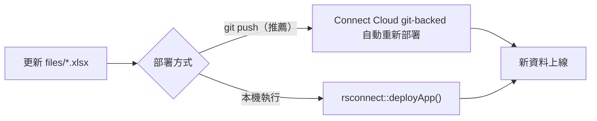

# 佈署到 Posit Connect Cloud

## 現況說明（與前版計畫的差異）

`data/*.csv` 已移除。`load_domain()` 的邏輯是：優先找 `files/*.xlsx`，找到就用，找不到才找 `data/`。現在 `files/` 是**唯一資料來源**，必須隨 bundle 打包。

**連帶影響：**
- `files/*.xlsx` 不能放進 `.rscignore`
- 構面信度以 xlsx 的 **dimMeta.reliability** 為正本（已修正 `load_domain()`，不再另讀 `dimReliability.csv`）
- Tab 1 匯入若執行，`save_domain_bundle()` 會從零建立 `data/` 目錄並寫入 CSV（ephemeral，重啟即消失）

**題庫日後替換流程（「replaceable」）：**
```
更新 files/*.xlsx → git commit/push 或直接 rsconnect::deployApp() → Connect Cloud 自動套用
```
資料以 xlsx bundle 為唯一正本，不需額外機制。

**信度資料模型：**
- 預設信度：`files/*.xlsx` 的 **dimMeta** 工作表 `reliability` 欄
- 波次專屬覆寫（選用）：xlsx 若有 **dimReliability** 工作表，或 app 內編修後寫入記憶體
- `get_dim_reliability()` 優先查波次專屬表，否則回退 dimMeta.reliability
- 不再從 `data/<domain>/dimReliability.csv` 讀取（xlsx 載入路徑已修正）

---

## 必要調整

### 1. 建立 `renv.lock`

Connect Cloud 要求 `renv.lock` 才能重現套件環境。

```r
# 在專案根目錄執行一次
renv::init()
renv::snapshot()
```

需確認 `renv.lock` 包含以下可選套件（目前用 `requireNamespace()` 載入，renv 可能漏掃）：

```r
renv::record(c("readxl", "visNetwork"))
renv::snapshot()
```

---

### 2. 建立 `.rscignore`

**`files/` 絕對不能排除**（是唯一資料來源）。只排除開發用檔案：

```text
# .rscignore
tests/
.Rhistory
.Rproj.user/
reports/*.html
*.plan.md
```

---

### 3. Tab 1 寫檔：加入 `KIT_READONLY` 環境變數守衛

在 Connect Cloud 上，Tab 1 的「匯入並覆蓋」會動態建立 `data/` 目錄並寫 CSV，但**重啟或重新部署即重置**，多個 worker process 同時寫入同一檔案也會互相覆蓋。

**做法：** 在 Connect Cloud 的環境變數設定 `KIT_READONLY=true`，app 偵測後停用寫入 UI。

在 [app.R](app.R) 最上方加：
```r
KIT_READONLY <- identical(Sys.getenv("KIT_READONLY"), "true")
```

在 [R/mod_domain_io.R](R/mod_domain_io.R) 的 `domainBundleServer` 裡：
- 把 `observeEvent(input$import_xlsx_btn, ...)` 包進 `if (!KIT_READONLY)` 條件
- UI 端用 `if (KIT_READONLY) tags$p("請下載 Excel 到本機修改後重新部署") else fileInput(...)` 條件渲染

Tab 2/3/4（篩選、構面報告、組卷 Word）完全不受影響。

---

### 4. 首次佈署

```r
library(rsconnect)
rsconnect::deployApp(
  appDir  = ".",
  appName = "kitItemBank",
  account = "<your-account>",
  server  = "connect.posit.cloud"
)
```

佈署完成後，在 Connect Cloud 介面：**Content → Settings → Environment Variables** 加入 `KIT_READONLY = true`。

---

## 流暢性調整（選做）

### 5. `setwd()` → `withr::with_dir()`

位置：[R/utils_dim_report_html.R](R/utils_dim_report_html.R)

目前：
```r
owd <- setwd(dirname(normalizePath(qmd_path)))
on.exit(setwd(owd), add = TRUE)
```

改為：
```r
withr::with_dir(dirname(normalizePath(qmd_path)), {
  # ... render 呼叫 ...
})
```

`setwd()` 是 process 全域狀態；同一 worker process 若兩個 session 同時觸發 Tab 3 報告，cwd 會互相踩踏。`withr::with_dir()` 安全封裝，且 `withr` 已在 renv 環境中。

---

### 6. Word 下載改為 `downloadHandler`

位置：[R/mod_assemble.R](R/mod_assemble.R) 的 `dl_word_btn`

目前走 base64 custom JS message（`kit_download_base64`），大型問卷 docx 編碼成 base64 走 websocket，部分瀏覽器的 popup blocker 會攔截 `URL.createObjectURL`。

改為標準 `downloadHandler`：
```r
# UI
downloadButton(ns("dl_word_btn"), "下載 Word 問卷", class = "btn-primary")

# Server
output$dl_word_btn <- downloadHandler(
  filename = function() {
    paste0("KIT_questionnaire_", format(Sys.time(), "%Y%m%d_%H%M%S"), ".docx")
  },
  content = function(file) {
    pkg <- collect_block_configs()
    doc <- generate_questionnaire(pkg$configs, pkg$data$itemBank)
    print(doc, target = file)
  }
)
```

Tab 3 構面報告的下載量較小，可保留 base64 機制不動，僅改組卷 Word。

---

### 7. 初始資料載入加 `bindCache()`

位置：[app.R](app.R) 的 `observeEvent(input$domain, ...)` 區塊

```r
domain_loader <- reactive({
  load_domain(input$domain)
}) |> bindCache(input$domain, cache = "app")
```

xlsx 在 bundle 固定不變，以 domain 名稱為 key 的 app-level cache 可讓同一台機器的多個 session 共用已解析的資料，減少冷啟動 I/O。只在 `KIT_READONLY=true` 時啟用（資料確定不會變動）。

---

## 資料更新工作流程（replaceable）



git-backed 方式需先在 Connect Cloud 設定 GitHub repo 連線；每次 push 自動觸發重新部署，不需手動執行 `deployApp()`。

---

## 資料安全提醒

部署到 Connect Cloud 表示 `files/*.xlsx` 題庫資料會存放在 Posit 託管的伺服器。Connect Cloud 免費方案的 app 預設為**私有**（需登入 Posit 帳號才能查看）。若資料屬於研究受試者個資，仍需依倫理審查結論決定是否雲端化。
